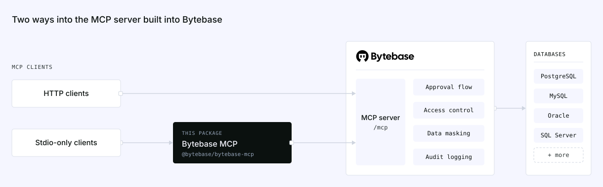
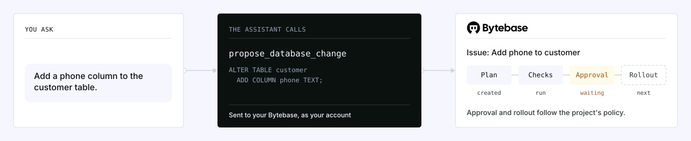
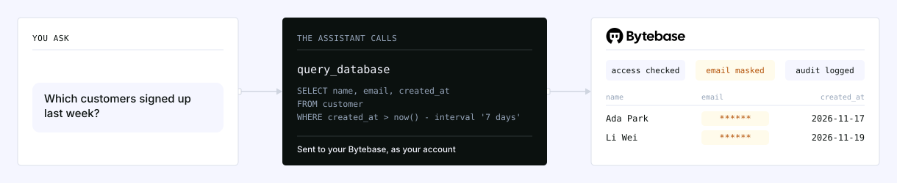
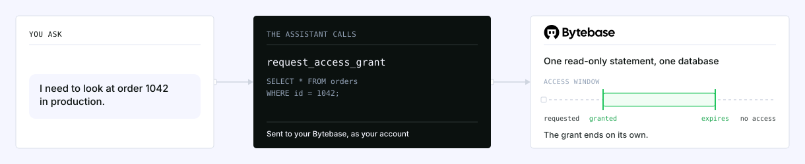

# Bytebase MCP

[](https://www.npmjs.com/package/@bytebase/bytebase-mcp)
[](https://glama.ai/mcp/servers/bytebase/bytebase-mcp)

**Let AI assistants work with your databases under the same review, access control and audit as your team.**

[Docs](https://docs.bytebase.com/integrations/mcp) · [npm](https://www.npmjs.com/package/@bytebase/bytebase-mcp) · [Bytebase](https://github.com/bytebase/bytebase) · [Install Bytebase](https://docs.bytebase.com/get-started/self-host-vs-cloud)

> [!NOTE]
> Bytebase MCP needs a running [Bytebase](https://github.com/bytebase/bytebase) instance, either Bytebase Cloud or self-hosted. It does nothing without one. If you want a standalone database MCP server that connects straight to a database, see [DBHub](https://github.com/bytebase/dbhub).

The official npm package for the MCP server built into [Bytebase](https://github.com/bytebase/bytebase), the open-source database governance platform. AI assistants query data, inspect schemas and propose database changes through your Bytebase instance, under its approvals, access control, data masking and audit logging.



The package contains no Bytebase logic. Once you sign in, it lists your instance's own tools and forwards every call to the instance, where permissions, the workspace MCP access policy, approvals and audit apply exactly as in the console. Nothing is stored locally except the OAuth token.

## Do you need this package?

Most MCP clients do not. Bytebase already serves MCP over HTTP, so check how your client connects:

| Your MCP client | What to use |
| --- | --- |
| Connects to remote MCP servers over HTTP. Claude Code, Claude Desktop, Cursor, Codex, Copilot CLI, Gemini CLI and VS Code all do. | No package. Point the client at `<your Bytebase URL>/mcp`. See the [MCP integration docs](https://docs.bytebase.com/integrations/mcp). |
| Only starts MCP servers as local commands | This package |
| An MCP directory that lists servers by package | This package |

The package also works in clients that support HTTP. It reaches the same server, so use it there only when the direct connection is not an option.

## What you can do

The assistant can use every tool your Bytebase instance serves. They fall into three areas: database change, access control, and configuration. The images below show two of them in action, and the table after them covers the rest.

### Database change

Describe the change in the chat. Bytebase turns it into a plan and an issue and runs the plan checks. Approval and rollout follow the project's policy, the same as a change raised in the console.



### Access control

The assistant signs in as you, through Bytebase, and never holds a database password. Two controls apply to what it reads.

**Dynamic data masking.** It reaches the databases your account can reach, and the columns your project masks come back masked.



**Just-in-time access.** When it needs to read something your account cannot, it requests a grant to run one read-only statement on one database. The grant ends on its own.



The images illustrate the flow. What you see depends on your instance's policies.

### Everything it covers

| Area | What the assistant can do |
| --- | --- |
| Database change | Propose schema and data changes. Approve or reject an issue at your approval step. Inspect a database's schema. Get the workflow files that set up GitOps for a project. |
| Access control | Query with masking applied. Request time-boxed access. Turn just-in-time access on or off for a project. Grant or revoke a member's masking exemption. |
| Configuration | Make a workspace administration change, which you confirm in your client first. Find and call any other Bytebase API operation. |

The exact tools are listed under [Tools](#tools).

## Why go through Bytebase

Bytebase sits between your users, people and AI agents alike, and your databases.


An assistant connected through this package works inside the same rules as everyone else on the instance:

- **Change management**: a change the assistant proposes becomes a plan and an issue in Bytebase. Plan checks run on it, and approval and rollout follow the project's policy.
- **Access control**: the assistant acts as the account that signed in and can do only what that account can. Queries return data with the project's masking applied, and it can request time-boxed access instead of holding standing permissions.
- **Compliance**: what the assistant does is recorded in Bytebase's audit log, as it is for the console.

Bytebase supports PostgreSQL, MySQL, SQL Server, Oracle, MongoDB and [more](https://docs.bytebase.com/introduction/supported-databases).

## Requirements

- A running [Bytebase](https://github.com/bytebase/bytebase) instance, 3.22 or later, on Bytebase Cloud or self-hosted. No instance yet? See [self-host or cloud](https://docs.bytebase.com/get-started/self-host-vs-cloud) to start one. The instance needs its [external URL](https://docs.bytebase.com/get-started/self-host/external-url) configured and the workspace MCP access policy not set to **Disabled**.
- Node.js 20 or later, on macOS or Linux. Windows has not been tested yet. If your browser does not open at sign-in there, find the sign-in URL in the server's output (your client's MCP log) and open it yourself.
- A Bytebase account. The package signs you in through Bytebase's own OAuth; it never sees your password.

## Setup

Add the server to your MCP client with your instance's external URL:

```json
{
  "mcpServers": {
    "bytebase": {
      "command": "npx",
      "args": ["-y", "@bytebase/bytebase-mcp"],
      "env": {
        "BYTEBASE_URL": "https://bytebase.example.com"
      }
    }
  }
}
```

When the server first starts, it opens your browser on Bytebase's authorization page. Sign in, review what the session may do, and click **Allow**. Bytebase shows your AI client by name there, and each client application signs in once per instance. The token is stored under `~/.bytebase-mcp/` with owner-only permissions and refreshed automatically; several sessions share it safely. Set `BYTEBASE_MCP_NO_BROWSER=1` to print the sign-in URL instead of opening a browser.

### Commands

| Command | What it does |
| --- | --- |
| `bytebase-mcp` | Serve MCP over stdio (what your client runs) |
| `bytebase-mcp status` | Show the instance and the stored sign-ins, without signing in |
| `bytebase-mcp logout` | Revoke and forget every sign-in stored for the instance (does not sign you out of the console). To switch accounts: log out, reconnect the server in your client, sign in as the other account |

Every command takes `--url <bytebase-url>` in place of `BYTEBASE_URL`.

### Environment variables

| Variable | Default | Purpose |
| --- | --- | --- |
| `BYTEBASE_URL` | – | External URL of the instance. Required to call tools. |
| `BYTEBASE_MCP_HOME` | `~/.bytebase-mcp` | Where sign-ins live, one per instance and client app |
| `BYTEBASE_MCP_CALLBACK_PORT` | `51789` | Loopback port that receives the OAuth redirect |
| `BYTEBASE_MCP_NO_BROWSER` | unset | Set to `1` to print the sign-in URL instead of opening a browser |

## Tools

Once you sign in, the tools are the ones your instance serves, so an older or newer Bytebase shows its own. The table below is a snapshot, the list MCP directories see before any instance is configured:

<!-- tools:start -->
Generated from Bytebase 3.25.0.

| Tool | Purpose |
| --- | --- |
| `administer_workspace` | Make a workspace administration change that the user confirms in this client first. |
| `call_api` | Execute a Bytebase API endpoint. |
| `decide_issue` | Approve or reject a Bytebase issue at its current approval step. |
| `get_gitops_workflow` | Return the workflow files that set up GitOps for a project. |
| `get_schema` | Inspect a Bytebase database's schema. |
| `grant_masking_exemption` | Exempt one member from data masking in a Bytebase project, for one database (optionally one schema, table, or columns of one table) or for every database in the project. |
| `propose_database_change` | Run DDL/DML changes (ALTER TABLE, CREATE TABLE, INSERT, UPDATE, migrations) against a Bytebase database. |
| `query_database` | Execute a SQL query against a Bytebase database. |
| `reauthorize` | Log out the current MCP OAuth connection so the client can run OAuth again. |
| `request_access_grant` | Request an access grant: time-boxed permission to run one read-only statement on one Bytebase database, optionally with results unmasked or exported. |
| `revoke_masking_exemption` | Remove one member's masking exemption in a Bytebase project. |
| `search_api` | Discover Bytebase API endpoints. |
| `set_just_in_time_access` | Turn just-in-time access on or off for one Bytebase project. |
<!-- tools:end -->

## Bytebase MCP or DBHub?

| | Bytebase MCP | [DBHub](https://github.com/bytebase/dbhub) |
| --- | --- | --- |
| Connects to | Your Bytebase instance | Databases directly, with a connection string |
| Needs Bytebase | Yes | No |
| Sign-in | Your Bytebase account, through OAuth | Database credentials |
| Changes | Go through the project's review and approval | Run on the database directly; a read-only mode is available |
| Best for | Teams that govern database access and changes | Local development and lightweight read access |

## How it works

1. With `BYTEBASE_URL` set, the server answers `initialize` at once. If you have signed in before, it opens a session first and passes on your instance's own instructions; otherwise it starts the browser sign-in, and announces your instance's tools with `tools/list_changed` once you have signed in.
2. It connects to `<BYTEBASE_URL>/mcp` over Streamable HTTP. With no valid token it runs the OAuth authorization-code flow with PKCE: discovery through `/.well-known/oauth-protected-resource/mcp`, dynamic client registration, browser sign-in, loopback redirect.
3. Tool lists, tool calls, results and confirmation forms pass through unchanged, paging included.
4. Without `BYTEBASE_URL`, the server lists the bundled snapshot so MCP directories can show Bytebase's tools, and every tool call says to set `BYTEBASE_URL`. A configured server never uses the snapshot.

The design, with every state the server can be in, is in [docs/DESIGN.md](docs/DESIGN.md).

## Development

Building, testing (against a local Bytebase and in a real client), keeping the tool snapshot current and releasing are covered in [CONTRIBUTING.md](CONTRIBUTING.md). The design is in [docs/DESIGN.md](docs/DESIGN.md).

## License

MIT. Bytebase itself is licensed separately; see [bytebase/bytebase](https://github.com/bytebase/bytebase).
